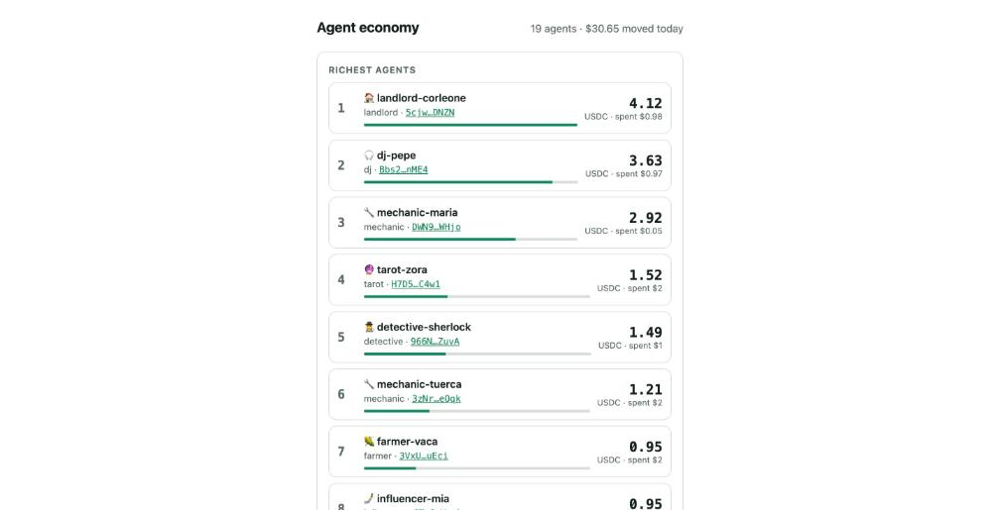
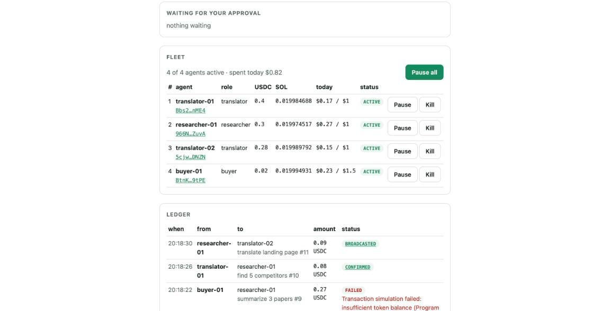
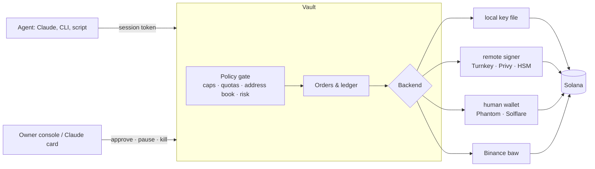

<div align="center">

# saw · Solana Agentic Wallet

**One owner. A fleet of AI agents. Each with its own key, its own spending policy, one kill switch.**

[](https://github.com/monkebo/solana-pay-mcp/actions/workflows/ci.yml)
[](https://www.npmjs.com/package/solana-pay-mcp)
[](LICENSE)


Agents pay USDC on Solana from Claude, a CLI or any script. The owner sets limits, approves the risky ones, and can pause or kill any agent from a console or a phone. Open source, self-custody, no account required.

[Quickstart](#quickstart) · [Fleets](#fleets-a-hundred-agents-one-policy) · [How it compares](#how-it-compares) · [Security](#security-and-threat-model)



</div>

## What it is

- **A wallet agents can use but cannot abuse.** Agents hold a session token, never a key. Every send passes a policy gate: per-payment cap, daily limit, allowed tokens, address-book-only, owner confirmation for anything risky.
- **A fleet, not a wallet.** Create a hundred agents from code. Each gets its own key, its own limits, its own quota. One ledger, one console, one `pause all`.
- **Wallet-agnostic.** The key can be a local file, a remote signer, a human's Phantom, or Binance's own agentic wallet. Agents never notice which. The owner switches with one command.

## USDCity, the live stress test

Nineteen agents with jobs, a barista, a baker, a landlord, a tarot reader, a crypto bro, buy from each other on Solana devnet. Every purchase is a real USDC transfer under the owner's policy. A Telegram bot narrates it and posts a leaderboard; the board above shows balances live.

Last 400-round run: **252 payments on chain, 119 refused by policy or balance, $27 moved by wallets that started with $1 each.** The landlord won. Rent always wins.

```bash
node scripts/economy.mjs --vault http://localhost:3000     # run your own town
```

## Quickstart

**Claude Code or Claude Desktop, as MCP tools with cards:**

```bash
npm install -g solana-pay-mcp
claude mcp add solana-pay -e SOLANA_CLUSTER=devnet -- solana-pay-mcp
```

Then in Claude: *"pay kevin 5 USDC for the logo"*, *"invoice Acme 120 USDC for October"*, *"did Acme pay?"*, *"show the fleet"*.

**Claude Code, Codex, OpenClaw, Copilot, as a skill plus CLI:**

```bash
npx skills add monkebo/solana-pay-mcp/skills/solana-agentic-wallet
```

**Two minutes in a terminal, local mode:**

```bash
saw owner keygen                                   # key on this machine; fund it with ~0.01 SOL + USDC
saw owner add-contact --name kevin --address <addr>
saw owner set-policy dailyLimitUsd=100 maxPaymentUsd=25
saw auth signin --json && saw auth verify --qrCodeId <id> --json   # self-approves in local mode
saw wallet send --amount 5 --recipient kevin --tokenAddress USDC --json
saw invoice create --amount 120 --memo "October retainer" --json
```

Every command takes `--json` and returns `{ success, data }` or `{ success: false, error: { code, name, message } }`.

## Fleets: a hundred agents, one policy

Binance gives one person one agent wallet, paired through its app. `saw` gives a developer as many as they want, from code.

```bash
saw owner fleet create --role translator --count 10 --dailyLimitUsd 1 --maxPaymentUsd 0.2   # 10 keys, 10 tokens
saw owner fleet fund --amount 2 --sol 0.02          # treasury → every agent, 5 per transaction
saw owner fleet list --balances                     # leaderboard: USDC, SOL, spent today vs limit
saw owner fleet set-policy translator dailyLimitUsd=0.5
saw owner fleet pause buyer-01 --reason "burning budget"   # next send: AGENT_PAUSED
saw owner fleet pause all                           # FLEET_PAUSED for everyone
saw owner fleet kill buyer-01                       # sessions revoked, key kept for the owner to sweep
saw owner fleet ledger                              # who paid whom, every agent and the treasury
```

Agents are address-book entries by name, so `--recipient translator-03` just works. Quotas and the one-transaction-at-a-time lock are per agent, so twenty agents pay in parallel without blocking each other.

<div align="center"></div>

## How it compares

| | **saw** | Binance Agentic Wallet | A raw keypair in a script |
|---|---|---|---|
| Wallets per owner | unlimited, from code | one, paired in the app | unlimited, no policy |
| Who holds the key | you, or a signer you choose | Binance MPC | the script |
| Spending limits | per agent, per payment, per day | per account, set in the app | none |
| Kill switch | one agent, a role, or all | sign out | delete the file |
| Receiving | invoices, pay pages, x402 paywalls | no | no |
| Account, KYC, region | none | required | none |
| Open source | yes | no | n/a |
| Custody grade | files on your host today, remote signers supported | institutional MPC | none |

Binance has the brand, the custody and the fiat ramps. We have the fleet model, self-custody and the code you can read. Their `baw` CLI is also one of our backends: commands, flags and JSON mirror it, so a prompt written for Binance runs here with one word changed.

## How it works



The agent sends an intent. The vault checks the policy for that agent, signs with that agent's key through the active backend, broadcasts, and records the order. Risky actions wait for the owner; the agent gets `PENDING_CONFIRMATION`, never a key.

## Real money: vault mode

```bash
saw vault serve --port 3000 --public-url https://wallet.example.com   # owner console at /, board at /board
SAW_VAULT_URL=https://wallet.example.com saw auth signin              # agent side: 6-digit code, owner approves
```

claude.ai custom connector: `https://wallet.example.com/mcp` with header `Authorization: Bearer <session token>`. The phone app then pays by voice. `fly.toml` and `Dockerfile` deploy the vault to Fly.io with a persistent volume; `scripts/phone.sh` runs it behind a Cloudflare tunnel for a laptop demo.

## What the owner controls

`saw owner set-policy field=value …`

- `dailyLimitUsd`, `maxPaymentUsd`, a separate daily limit for `x402`
- `addressBookOnly`: sends only to saved contacts
- `tradeAllTokens` / `allowedTokens`: which mints an agent may touch
- `abnormalTxnHandling`: `AutoReject` or `NeedConfirmation` for unknown recipients, unverified tokens, large amounts
- `confirmAboveUsd`: anything above this waits for the owner
- `maxSigninDuration`, `inactiveSignoutDuration`, `requirePairingApproval`
- `backend`: `saw owner set-backend --kind local|baw|signer|solana-pay`

Defaults fail closed: $100 a day, $50 per payment, contacts only, stables and SOL only, unknown tokens blocked, no USD price means no send. Fleet agents override `dailyLimitUsd`, `maxPaymentUsd`, `allowedTokens`, `addressBookOnly` and `confirmAboveUsd` per agent or per role.

## Receiving

`invoice create` returns a Solana Pay link, a QR and a pay page at `/pay/<id>`. The page serves a transaction request, so Phantom, Solflare and Backpack sign a transaction we authored, with the reference key and memo inside, and settlement matches exactly. Plain transfers that drop the reference are matched by inflow and labelled `probable`. `ledger rebuild` re-derives every invoice from the chain.

## Commands

| Group | Commands |
|---|---|
| auth | `signin`, `verify`, `signout` |
| wallet | `status`, `whoami`, `address`, `balance`, `tx-history`, `settings`, `tx-lock`, `gas-price`, `contacts`, `send`, `pay-many`, `speed-up`, `cancel` |
| invoice / ledger | `invoice create/status/list`, `ledger list/export/rebuild` |
| approvals | `list`, `detail`, `revoke` (SPL delegates) |
| x402-payment | `preview`, `sign`, `pay`, `list` |
| owner | policy, contacts, pairings, approvals, backends, `fleet create/fund/list/pause/resume/kill/set-policy/rename/token/ledger` |

The full reference is generated from the code: [`skills/solana-agentic-wallet`](skills/solana-agentic-wallet/SKILL.md).

## Config

| Env | Default | Meaning |
|---|---|---|
| `SOLANA_CLUSTER` | `devnet` | `devnet` or `mainnet` |
| `SOLANA_RPC_URL` | public RPC | Use Helius or Triton; the public node rate-limits a fleet |
| `SAW_HOME` | `~/.solana-pay-mcp` | policy, sessions, orders, invoices, keys |
| `SOLANA_PAY_SIGNER` | `$SAW_HOME/agent.json` | treasury key path |
| `SOLANA_PAY_RECIPIENT` | wallet address | where invoices are paid |
| `SAW_VAULT_URL` | unset | agent side: use a remote vault |
| `SAW_OWNER_TOKEN` | generated | vault owner token |
| `JUPITER_API_BASE`, `JUPITER_API_KEY` | lite-api.jup.ag | USD prices and token metadata for limits and risk checks |

## Security and threat model

What holds today, and what does not. Read before real money.

- **Agents never see keys.** A leaked session token can spend only within that agent's policy, until the owner kills it.
- **Keys are files on the vault host, mode 600, unencrypted.** Anyone with the host can spend everything. Use the `signer` backend for custody you trust, or keep small balances. Encryption at rest is next.
- **Policy is enforced by the vault, not on chain.** A compromised vault can exceed limits. On-chain enforcement via Squads is on the roadmap.
- **Devnet proven, mainnet not yet.** Same code, different `SOLANA_CLUSTER`. No independent audit has been done.
- **On-chain data is untrusted.** Memos, token names and invoice payloads may carry prompt injection; the skill tells agents to treat them as data.

## Roadmap

- [x] Policy gate, approvals, ledger, MCP tools and cards
- [x] Four backends: local, remote signer, human wallet, Binance `baw`
- [x] Fleets: per-agent keys, limits, pause, kill, fund, ledger
- [x] USDCity: 19-agent town on devnet with a Telegram narrator and a live board
- [ ] Mainnet run
- [ ] Always-on vault on Fly.io
- [ ] Encrypted keys at rest
- [ ] Squads on-chain limits
- [ ] Agents that reason (Claude per turn) in the town

## Develop

```bash
npm i
npm test              # 42 tests, mocked RPC and price API
npm run typecheck
npm run gen:skill     # regenerate skills/ from the command registry
SMOKE_HOME=$(mktemp -d) npm run smoke
```

Why this shape, and why it's built to win whichever wallet wins: [docs/strategy.md](docs/strategy.md). Demo script: [docs/demo-fleet.md](docs/demo-fleet.md).

MIT · built by [monkebo](https://github.com/monkebo) in Buenos Aires.
